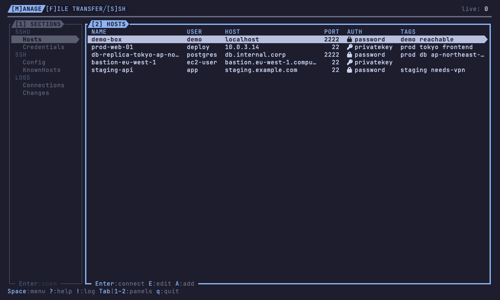

# sshu

<p align="center"></p>

[](https://github.com/vulcanshen/sshu/releases)
[](https://go.dev/)
[](LICENSE)
[](https://github.com/charm-and-friends/charm-in-the-wild#networking-and-file-transfer)

**語言**：[English](README.md) · 繁體中文

**ssh 與 sftp 的終端機前端。** host 收在一個檔案裡，想開幾個 shell 就開幾個、並排看著，任兩台機器之間的檔案直接搬。`Tab`、`Enter`、`Esc`、`Space`、`?` 驅動一切：不用背快捷鍵，也不用設定。

> _不確定的時候，就按_ **`Space`**。

靈感來自 [Termius](https://termius.com/) —— hosts、sessions、檔案傳輸收在同一個屋簷下 —— 只是搬進了終端機。

## Demo



## 特色

- **不用背任何東西** —— 在任何 panel 上按 `Space`，列出來的就是這裡能做的全部；每一個字母快捷鍵都是那個 menu 裡的一列，`?` 列出這裡的鍵。
- **活 ssh session 的網格** —— 每一格都是自己終端機上的真 `ssh`，同時開幾個都行，可以水平、垂直或照欄數排。`PgUp` 翻這個 session 的歷史，`Alt-v` 從裡面選字複製，`Alt-z` 讓一格佔滿整個網格，`Alt-Enter` 把每一個鍵交給格子裡巢狀的 sshu。
- **任兩台機器之間傳檔** —— 本機 ↔ 遠端 ↔ 遠端，同一個畫面。可以搜尋整棵子樹、不抓下來就先讀檔，或直接用你自己的 `$EDITOR` 打開、改完寫回去。
- **就地管理你的 `~/.ssh` 檔案** —— 瀏覽、編輯 `~/.ssh/config` 與 `~/.ssh/known_hosts`，註解一行都不會掉。`auth: sshconfig` 的 host 什麼都不存，全部交給 `~/.ssh/config` 決定 —— ProxyJump、agent、金鑰都算在內。
- **可重用的 credential** —— 一個 user 和它的驗證方式定義一次，任意數量的 host 都能引用。
- **tag** —— 你自己下在 host 上的字，篩選找得到：打 `prod`，整群就出來了。
- **看得懂的失敗** —— 不正常結束的 session 會說出 ssh 自己講了什麼；按 `!` 打開 App Log：sshu 開著以來做了什麼、哪裡出了錯，遠端講的話也都在。Manage 裡還留著每一次連線、每一筆你改過的東西的紀錄。
- **密碼在磁碟上是加密的** —— 而且從不顯示，也不經過環境變數。

## 安裝

> sshu **只支援 macOS 與 Linux**（它用 Unix PTY），沒有 Windows build —— 請用 WSL。

**Homebrew**（macOS / Linux）：

```bash
brew install vulcanshen/tap/sshu
```

**安裝腳本**（把最新 release 的 binary 放進 `~/.local/bin`，root 則是 `/usr/local/bin`）：

```bash
curl -fsSL https://raw.githubusercontent.com/vulcanshen/sshu/main/install.sh | sh
```

從原始碼建置見 [`docs/dev-remarks.md`](docs/dev-remarks.md)。

### 需求

- **Nerd Font** —— 必要，不是選配：auth 方式、檔案類型、標記都用 Nerd Font 的 glyph 畫。sshu 啟動時會問終端機，一個 icon、一個 powerline 符號各讓游標前進幾格；量錯了就自己設（填 `1` 或 `2`）：

  | 變數 | 誰會讀 |
  |---|---|
  | `SSHU__ICON_WIDTH`、`SSHU__POWERLINE_WIDTH` | 只有 sshu |
  | `TERMINU__ICON_WIDTH`、`TERMINU__POWERLINE_WIDTH` | [terminu family](#terminu-family) 的每一個 app —— 設一次全家族都讀到；在家族 app 的終端機裡跑時，外層的 app 會替你設好 |

  隔著 ssh 時，sshu 會把自己的這兩個數字用 `LC_TERMINU_ICON_WIDTH`、`LC_TERMINU_POWERLINE_WIDTH` 帶過去（sshd 預設接受 `LC_*`），遠端的家族 app 也畫得對。

- **至少 60×20** —— 終端機比這小時，sshu 只顯示名稱、要多大和怎麼離開，視窗拉大後回到原本的畫面。
- **truecolor 終端機**（24-bit 色）—— 配色裡的淡色、popup 的層色、popup 底下變暗的畫面，在 256 色下都分不出來。
- **會送出 Alt 的終端機** —— sshu 的 `Alt-…` 鍵（離開 session 的 `Alt-Esc`、`Alt-z`、`Alt` 加方向鍵）需要 Option 鍵當 Meta 用。macOS 內建的 Terminal 要開「Use Option as Meta key」，iTerm2 要把 Option 設成 *Esc+*；kitty、Alacritty、WezTerm 預設就會送。
- **OpenSSH 的 `ssh`**：SSH 畫面要用（每台 macOS、Linux 都有）。檔案傳輸自己講 SFTP，不需要。

### 第一次啟動

一打開是 Manage → Hosts，清單是空的；sshu 會建好 `~/.sshu`，以及之後拿來加密密碼的鑰匙（見[你的資料放在哪](#你的資料放在哪)）。

從舊版 sshu 升上來的，放在別處的東西會在第一次啟動時搬過去：macOS 上的設定目錄從 `~/Library/Application Support/sshu` 搬到 `~/.config/sshu`，host、credential、加密它們的鑰匙與紀錄從設定目錄搬到 `~/.sshu`（鑰匙跟它加密的檔一起搬，不然就全部留著），一項一項搬，畫面上會說從哪裡搬到哪裡。新位置已經有的留在舊位置，搬不動的照舊在原位置使用：sshu 會寫出兩個路徑，讓你自己合併或搬。

### 移除

```bash
curl -fsSL https://raw.githubusercontent.com/vulcanshen/sshu/main/uninstall.sh | sh
```

移除 binary 之後，會先問過你才碰設定目錄，以及資料目錄（你的 host 和 credential 都在那裡）。

## 快速開始

```bash
sshu
```

按 `A` 加第一台 host，在它上面按 `Enter` 連線。`F` 切到檔案傳輸，`S` 切到 session 的網格。不知道下一步要做什麼，就按 `Space`。

## 使用方式

三個畫面，用 `M`、`F`、`S` 切換（或從 `Space` → Global operation）：

```
 [M]anage  [F]ile transfer  [S]SH
```

到處都能按的鍵：

| 鍵 | 行為 |
|---|---|
| `Space` | 這裡能做什麼：focus 那個 panel 的 menu；最後一列打開全域動作（切畫面、離開） |
| `?` | 最前面那一層能按的鍵 |
| `!` | App Log：sshu 開著以來做了什麼、哪裡出了錯，最新的在最下面；有沒看過的錯誤時 footer 會說 |
| `Tab`、`1`–`9` | 下一個 panel，或這個畫面的第 N 個 panel |
| `Enter` | 理所當然的那件事：連線、打開、進去 |
| `Esc` | 退一步 —— 關掉最上面的 popup、清掉篩選、回上層目錄 |
| `j\|k`、`u\|d`、`gg\|G` | 往下與往上、半頁、到頭與到尾（方向鍵也行） |
| `q\|Ctrl-C` | 離開；有 session 或傳輸在跑時會先問，再按一次 `Ctrl-C` 立刻離開 |

下面每一個字母快捷鍵，同時都是那個 panel 的 `Space` menu 裡的一列。**方括號印的大小寫就是你要按的鍵**：`[A]dd` 是 `Shift-A`、`[t]ransfer` 是裸的 `t`。

### Manage

`[1]` 列出 sshu 管的東西 —— **SSHU**：Hosts、Credentials；**SSH**：Config（`~/.ssh/config`）、KnownHosts（`~/.ssh/known_hosts`）；**Logs**：Connections、Changes。`[2]` 顯示游標那一項；`Enter` 或 `2` 把鍵盤移過去。

| 鍵 | 行為 |
|---|---|
| `Enter` | 在 host 上：先看它連到哪裡、怎麼驗證，再按一次 `Enter` 連線。其他地方：唯讀看全部（密碼一律遮起來） |
| `A` | 新增 host、credential、`Host` 區塊，或 known host 的金鑰（sshu 先向那台機器要金鑰、給你看過指紋，才決定要不要信任） |
| `E` | 編輯游標這一列 |
| `D` | 複製：開一個從這一列預先填好的新增表單 |
| `X` | 刪除（先問） |
| `/` | 篩選 host：name、user、host、port、tags 一起比對 |
| `C` | Connections、Changes：清空這一本（先問） |

表單裡 `j|k` 換欄位，`Enter` 改游標那一欄，`Tab` 到按鈕。

`Host` 區塊的表單裡，`HostName`、`User`、`Port`、`IdentityFile` 各有一欄；這個區塊其他的關鍵字列在 *Others*。按 *Edit file* 會在表單上面用你的 `$EDITOR` 打開那個檔、停在這個區塊那一行；表單有改動時會先問要不要存，因為編輯器打開的是磁碟上的檔。編輯器關掉後，表單顯示檔案現在的內容。

### File transfer

左右兩側，各自可以是本機或某台已存的 host：上面是檔案，下面是你標記的 —— 左邊 `[1]` `[2]`、右邊 `[3]` `[4]`。`h|l` 跨到另一側。`local` 開在你啟動 sshu 的目錄，所以 `cd ~/release && sshu` 一進去就在那裡。

| 鍵 | 行為 |
|---|---|
| `Enter` | 進入目錄；在檔案上是讀它 |
| `Esc` | 回上層目錄 |
| `a` | 標記 / 取消標記 |
| `t` | 傳到另一側的當前目錄 |
| `r` | 改名 |
| `v` | 讀它 —— 文字帶語法上色，二進位轉 hex，目錄列出內容 |
| `e` | 用 `$EDITOR` 編輯；遠端的檔案會抓下來、改完寫回去。編輯器裡按 `Alt-Esc` 結束編輯器（先問）；存過的內容會寫回 |
| `x` | 刪掉它（先問） |
| `/` | 搜尋這個目錄底下整棵樹，游標那一項的預覽在旁邊；在結果上按 `Enter` 就到那裡 |
| `A` | 新增：`name` 建檔案，`name/` 建目錄 |
| `R` | 重讀這個目錄 |
| `H` | 選這一側的 host（`local` 排第一） |
| `D` | 這一側斷線，或叫停正在連的那一次 |

在標記的 panel 上，`Enter` 打開那個標記（目錄在檔案 panel 打開，檔案就讀它），`r`、`v`、`e`、`t`、`x` 作用在游標那一個標記，`c` 清掉這個標記（磁碟上什麼都不動）；另外三個鍵作用在這一側全部的標記：`T` 全部傳過去，`X` 全部刪掉（先問），`C` 全部清掉。`J` 在哪裡都能按，列出這次啟動以來的傳輸：在進行中的上按 `Enter` 取消它，結束的看全文。

現在按不了的列在 menu 裡是暗的，按它的鍵也沒有反應：傳輸進行中的 `H` 和 `D`、還在傳進來的檔案上的 `a`、目錄上的 `e`、另一側還沒有 host 時的 `t` 和 `T`。

### SSH

`[1]` 活著的 session，`[2]` 網格怎麼排，之後每個 session 一個 panel（`[3]` 起）。在 session（或它的格子）上按 `Enter` 把鍵盤交給它；之後每一個鍵都屬於遠端，只有這幾個例外：

| 鍵 | 行為 |
|---|---|
| `Alt-Esc` | 把鍵盤收回來，回到 `[1]` 的那個 session（先問：在 vim 裡快速按兩下 `Esc` 可能被讀成 `Alt-Esc`；`Esc` 回到 session 裡） |
| `Alt-←\|→\|↑\|↓` | 那個方向的格子 |
| `Alt-z` | 這一格佔滿整個網格，再按一次還原 |
| `Alt-v` | 在格子裡選字，`v` 開始選、`y` 複製、`Esc` 取消選取；`Space` 列出能按的鍵 |
| `Alt-Enter` | 鎖定：每一個鍵都交給格子，`Alt-Esc` 也是，給格子裡巢狀的 sshu；這時 `Alt-Enter` 是出口，離開格子就解鎖 |
| `PgUp` | 這個 session 的歷史：`j\|k`、`u\|d`、`gg\|G`、`PgUp\|PgDn` 捲動，`Esc` 回到即時畫面，`Space` 列出能按的鍵（其他鍵都送給 session） |

還在連線的格子會寫出正在連哪一台，打的字等 ssh 連上才送出去。

在 `[1]` 上：`H` 把這個 session 的格子從網格上拿掉、或放回去，`C` 關掉它（先問），`D` 對同一台再開一個；「全部關掉」（Close all sessions）在 `Space` menu 裡。在 `[2]` 上選水平、垂直或自訂，自訂的話再設欄數。

## 設定

### 你的資料放在哪

兩個目錄：sshu 自己的設定一個，你的資料一個 —— 你寫的 host 與 credential，以及 sshu 記的紀錄。

| 設定目錄 | |
|---|---|
| `$SSHU__CONFIG` | 有設就用這個目錄 |
| `$XDG_CONFIG_HOME/sshu` | 有設就用 |
| `~/.config/sshu` | 都沒有時，每個平台都是這裡 |

資料放在 `~/.sshu`（有設 `$SSHU__DATA` 就用它）。

| 檔案 | 在哪 | 內容 |
|---|---|---|
| `hosts.yaml` | `~/.sshu` | 你的 host |
| `credentials.yaml` | `~/.sshu` | 可重用的身分 —— 一個名字、一個 user、以及它怎麼驗證；host 用 `auth: credential` 加 `credential: <名字>` 引用 |
| `config.yaml` | 設定目錄 | 設定（選用，見下方） |
| `state.yaml` | 設定目錄（`$SSHU__STATE` 可以搬走） | SSH 網格怎麼排；sshu 自己寫，刪掉只是回到預設 |
| `.sshukey` | `~/.sshu` | 加密密碼用的鑰匙 |
| `connections.yaml` · `changes.yaml` | `~/.sshu` | 兩本紀錄 |

全部都是可以手改的 YAML，權限維持 `0600`。

這些檔有哪個 sshu 讀不了（`hosts.yaml` 打錯字、沒有權限開），啟動時會先問：`Enter` 把它改名成 `hosts.yaml.bak`（已經有了就用 `.bak.1`，依此類推，不會蓋掉），sshu 照第一次打開那樣開始；`Esc` 離開 sshu，並印出是哪個檔、為什麼。鑰匙讀不了時另外問：它加密過的密碼原封不動，舊的鑰匙放回去就打得開。

### 設定 —— `config.yaml`

選用；sshu 只讀不寫，所以你的註解和排版都不會被動到。沒寫的項目用預設值。

```yaml
# 一次連線嘗試的時間上限，單位秒（1–600），預設 15。
connect_timeout: 15
# terminu family 共用：identity file 選檔器的預覽裡，私鑰只顯示第一行，
# 只有你能讀的檔整個不顯示。預設 false。
hide_secrets_in_preview: false
# terminu family 共用：讀檔與預覽時，一個 Tab 畫成幾格。預設 4。
input_tab_width: 4
```

### 密碼

存起來的密碼用 AES-256-GCM 加密，所以 `password:` 那一欄是 `ENC:…`。鑰匙是同一個目錄裡的 `.sshukey`，第一次啟動時自動產生；想放到別處，設 `SSHU__KEY_FILE`。

|  |  |
|---|---|
| **擋得住** | 只有 `hosts.yaml` 或 `credentials.yaml` 流出去 —— 貼到聊天室、不小心 commit、被備份掃走 |
| **擋不住** | 整個資料目錄被複製走，因為**鑰匙就在裡面**；以及任何以你的身分在跑的其他程式 |

所以 **`~/.sshu` 不要進版控、不要放進同步資料夾、不要讓備份掃到。** 想連「整個目錄被複製」都擋住，就用 `SSHU__KEY_FILE` 把鑰匙放到別的地方 —— 但那把鑰匙得你自己備份，鑰匙掉了，存起來的密碼就全部跟著沒了。

密碼從不顯示在畫面上，交給 `ssh` 的方式是 `SSH_ASKPASS`，不會經過環境變數或命令列。如果你根本不想讓 sshu 存密碼，用 `auth: privatekey`（只存一條路徑）或 `auth: sshconfig`（什麼都不存）。

### Host key

- **SSH 畫面** —— 執行的是真的 `ssh`，所以 host key 由 OpenSSH 處理，用的是你的 `~/.ssh/config` 和 `known_hosts`。
- **檔案傳輸** —— 未知的 host、變過的 key 都直接拒絕，不會問你。要接受一台新機器，先從 SSH 畫面連一次，或在 Manage → KnownHosts 按 `A`。（`auth: sshconfig` 的 host 在這裡也走真的 `ssh`，問的是 OpenSSH 自己的提示。）

## 已知限制

- 檔案傳輸無法對 password、privatekey、credential 的 host 互動確認未知的 host key —— 先從 SSH 畫面接受它。
- 檔案傳輸上，`privatekey` host 不能用有 passphrase 的私鑰；改用 `auth: sshconfig` 的 host，它走 `ssh` 和 agent。
- 不能搜尋遠端檔案的內容。
- 沒有滑鼠支援、`hosts.yaml` 在磁碟上改了不會自動重讀、不保存 session、密碼不存進 keychain。

## 相關連結

- [CHANGELOG.md](CHANGELOG.md) —— 每一版改了什麼
- [`docs/dev-remarks.md`](docs/dev-remarks.md) —— 開發者備忘：運作方式、設計理由、建置與測試

## terminu family

sshu 遵循 [terminu design principle](https://github.com/vulcanshen/terminu/tree/v0.11.0/principle)，畫面建在 [terminu-go](https://github.com/vulcanshen/terminu-go) 上：跟家族其他成員同一套按鍵、同一種 menu —— [kbu](https://github.com/vulcanshen/kbu)（Kubernetes）、[filu](https://github.com/vulcanshen/filu)（檔案）、[webu](https://github.com/vulcanshen/webu)（網頁）、[locku](https://github.com/vulcanshen/locku)（螢幕鎖）、[kamonu](https://github.com/vulcanshen/kamonu)（家族的 mark）與 [ccdrawu](https://github.com/vulcanshen/ccdrawu)（Claude Code 的側欄）。

## License

[GPL-3.0](LICENSE)
